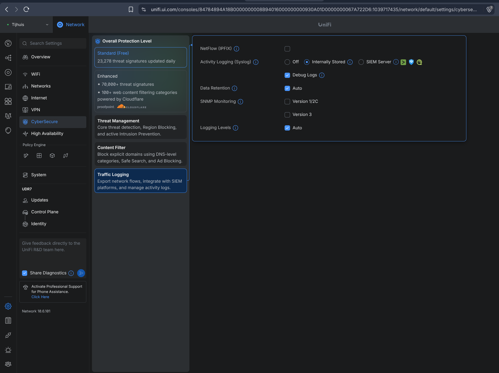
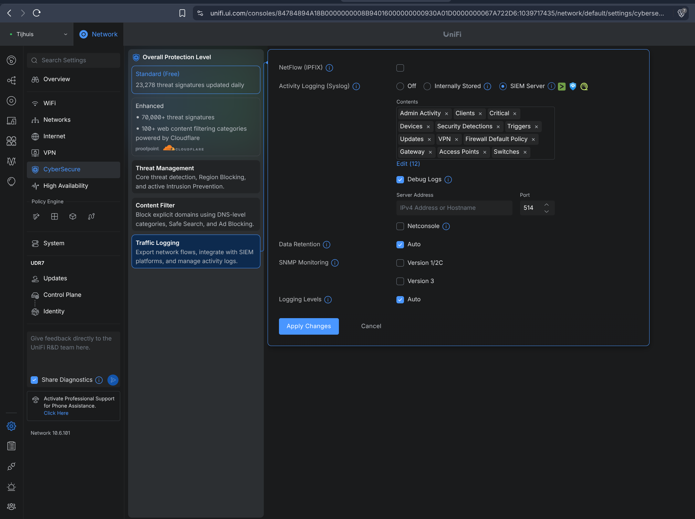
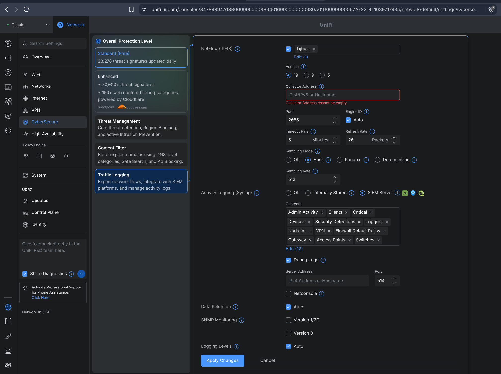
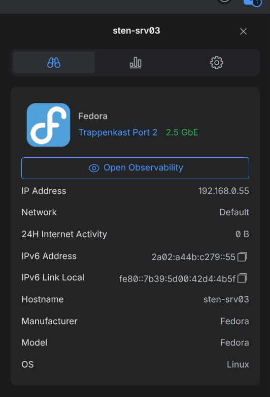
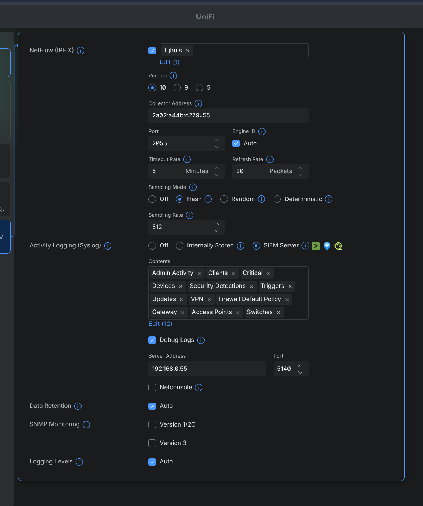

# Week 1-2: SIEM

Wazuh + OpenObserve/OTel Collector, een moderne rootless vervanger van Security
Onion + ELK. Bewaakte infrastructuur is mijn eigen thuisnetwerk in plaats van
een wegwerp-labje. Dashboard is Wazuh's eigen UI (OpenSearch Dashboards, een
Kibana-fork).

## Componenten

1. **UniFi-netwerk**, syslog: firewall/IPS-logs, DHCP-logs. Daarnaast NetFlow
   (IPFIX) voor volledige flow-accounting (wie praat met wie, bytes/packets,
   poorten) — syslog logt alleen losse events, geen verkeer dat niet tegen
   een regel botst. Aanzetten via Settings > CyberSecure > Traffic Logging >
   NetFlow (IPFIX) in de UniFi-console, gericht op de SIEM-server op poort
   2055/udp. Niet elk gateway-model ondersteunt dit (o.a. kale UDM, UDR,
   UXG-Lite niet).
2. **Container "linux-server"**, Wazuh-agent: SSH-auth, File Integrity Monitoring
3. **Container "web-app"**, Wazuh-agent + nginx: access-logs, vulnerability-detectie

Alerts: brute-force SSH, FIM-wijziging.

## Keuze: OpenObserve i.p.v. SigNoz

Twijfel gehad tussen SigNoz en OpenObserve voor de niet-security telemetrie.
OpenObserve wint het op integratiegemak en efficiëntie: één binary tegenover
SigNoz's ClickHouse + query-service + frontend, en dat weegt zwaarder naast
Wazuh's toch al zware indexer op één laptop.

## Draaien

```bash
sudo pacman -S --needed podman podman-compose   # CachyOS
brew install podman-compose                     # Bazzite, podman zit er al in

cd compose
./setup.sh      # start, print bij eerste run de wachtwoorden
./restart.sh
./stop.sh       # --wipe ruimt ook volumes/certs/.env op
```

Wachtwoorden staan in `.env` (git-genegeerd, aangemaakt vanuit `.env.example`).

## Logboek

### UniFi: NetFlow + syslog naar SIEM

Ingelogd op de router-console (UDR7). Onder **CyberSecure > Traffic Logging**
staan NetFlow-export en syslog-naar-SIEM naast elkaar.



Eerst Activity Logging (Syslog) van "Internally Stored" naar "SIEM Server"
gezet en alle logcategorieën aangevinkt, zodat er niets gemist wordt.



Daarna NetFlow (IPFIX) aangezet. UniFi waarschuwde dat dit de doorvoersnelheid
zou verminderen; hier ben ik akkoord mee gegaan. De UDR7 trekt dit denk ik
prima, en met een VDSL-bonded lijntje van 190 Mb/s down / 54 Mb/s up is er
sowieso genoeg ruimte over.



Eenmaal alles ingeschakeld kan ik een serveradres invoeren waar alle data
naartoe wordt verzonden — dat wordt sten-srv03 (zie hieronder).

### Server: sten-srv03

Als server zet ik een van mijn NUC's in, binnen het netwerk bekend als
"sten-srv03". Dit wordt de centrale endpoint waar alle informatie naartoe
verstuurd wordt. De server draait Fedora 44 en heeft een admin console
(Fedora Cockpit) waarop de draaiende containers van de Wazuh/OpenObserve
Podman-compose-stack te zien zijn (screenshot nog maken).



sten-srv03 heeft de volgende adressen:

| Protocol | Adres |
| --- | --- |
| IPv4 | `192.168.0.55` |
| IPv6 | `2a02:a44b:c279::55` |

Als collector-adres heb ik het IPv6-adres gebruikt voor NetFlow (IPFIX) en het
IPv4-adres voor Activity Logging (Syslog) — puur om straks in de logs te
kunnen zien of dat verschil ook echt zichtbaar is. Verder ondersteunt Unifi geen IPv6 syslog (en ik weet zo gauw niet of het uberhaupt kan). Dus vond het leuk om beide adressen echt te benutten en de dual-stack te testen.



Poort staat nu goed op `5140`, matcht de syslog-receiver van de collector.
